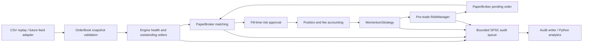

# Architecture

This milestone is a single-instrument paper execution engine. It consumes validated broker-style top-of-book snapshots and produces simulated orders, fills, inventory, fees, and marked PnL. It has no broker connection or exchange gateway. `LiveBroker` is a fail-closed placeholder that returns `live_disabled`.

## Responsibilities and boundaries

| Component | Responsibility | Latency choice |
| --- | --- | --- |
| `types.hpp` | Integer paise, unit quantities, monotonic nanoseconds, fixed enums and records | Fixed-size values avoid formatting and allocation in execution methods. |
| `OrderBook` | Validates symbol, sequence, time, tick size, price bands, spread and displayed size | One cached snapshot gives constant-size access to bid, ask and mid. |
| `MomentumStrategy` | Example momentum signal from consecutive midpoint changes | Keeps one previous midpoint; signals use the same code during replay. |
| `RiskManager` | Health, order size, independent pending buy/sell exposure, notional, open-order and request limits | Inline checks operate on bounded arrays; they cannot be bypassed by the strategy. |
| `PaperBroker` | Simulates latency, FIFO order matching, partial fills, IOC cancellation, deterministic rejection and fees | Preallocated order slots and monotonically increasing IDs avoid dynamic containers. |
| `Engine` | Orders validation, matching, fill approval, signal generation, cancellation and stop behavior | A single owner serializes state changes without locks. |
| `SpscQueue` | Transfers fixed audit events to one consumer | Acquire/release atomics and separate cache lines avoid producer/consumer locks. |
| Replay and analytics | Parsing, files, reports and process control | These run outside the execution methods. |

The engine methods contain no heap allocation, string construction, blocking calls or network I/O. The SPSC queue permits exactly one producer and one consumer. Engine state itself is single-thread-owned; callers must not invoke its mutation methods concurrently. Parsing, object construction, CSV output and Python analysis may allocate. A replay runner can drain the queue after each tick; a future live adapter can dedicate a consumer thread to audit output.

## Event order and simulation model

1. Reject duplicate/regressing sequence numbers and regressing timestamps before matching. Such events cannot replenish simulated liquidity.
2. Check the gap against the previous accepted tick. A stale gap cancels old orders before the new snapshot can fill them.
3. Validate and install the new snapshot; assess feed/session, marked exposure and loss controls.
4. Match previously accepted orders whose `ready_at` time has arrived. Recheck prospective exposure before each fill and health after it.
5. Run the strategy, then apply pre-trade checks before accepting a new pending order.

An order generated from a tick cannot fill on that same call. Its earliest opportunity is a later accepted snapshot with `time >= submission_time + latency_ns`. No interpolation invents quotes between recorded snapshots. Latency is simulated using event timestamps; replay need not wait in wall-clock time.

Each snapshot supplies a shared bid and ask quantity budget. Eligible orders consume that budget in accepted-ID order, including when an array slot has been reused. A limit order fills only when the opposite touch plus configured adverse slippage is within its limit. A market order is protected by its submission-time adverse-price bound; a worse later price rejects it. Partial DAY limits may rest; IOC and market remainders cancel at the first eligible matching opportunity. Deterministic `reject_every` fault injection can reject submitted orders.

This is a top-of-book model. It does not reconstruct depth, exchange queue priority, hidden liquidity, adverse selection or market impact. Fresh recorded snapshots replenish displayed liquidity; repeated distinct snapshots do not prove that liquidity would have remained executable in a real market. Simulated results should be interpreted within those limits.

## Accounting and safety behavior

Prices, cash flows, notional, fees and equity use integer paise. Quantities are units, with lot-size validation. The fee model includes configurable brokerage, buy/sell STT, exchange charges, SEBI charges, buy-side stamp duty and GST. It calculates cumulative order-turnover fees and debits the delta on each partial fill, so splitting one order does not repeatedly apply its brokerage cap. Rates and rounding are illustrative rather than a verified Indian contract-note calculator.

PnL is net trade cash flow plus inventory valued at the current midpoint, starting from zero trade cash flow. It is marked PnL; it is not proof of executable liquidation proceeds. Existing inventory remains on shutdown. There is no automatic flattening, capital/margin ledger, delivery settlement, derivative contract model or MIS square-off service.

Pre-trade exposure counts pending buys and sells independently so opposing working orders cannot mask a worst-case position. The notional policy is intentionally conservative and may reject a risk-reducing order while other reservations consume its budget. Fill-time approval also checks prospective marked inventory, remaining reservations and actual fill turnover before accounting changes. IDs must increase throughout the session; a rejected ID is consumed and must not be retried as a new order. Replacement is cancel-first: if the replacement fails, the old order remains cancelled.

Manual stop, disconnect, stale feed, invalid configuration/data, marked loss and marked-exposure violations can stop execution. A kill latches for the engine's lifetime and cancels all working orders. A normal session-close snapshot cancels working orders and blocks new orders while closed. It does not itself create a permanent kill. Shutdown cancels working orders but leaves inventory visible for reconciliation.

The audit queue holds 2,048 fixed events. If it fills, the engine latches a capacity kill and cancels working orders instead of continuing without an audit trail. The event that encountered a full queue, and subsequent cancellation records, may not fit. `audit_failed()` reports that the trail is incomplete; such a run must not be treated as fully audited.

## Session scope

One engine represents one instrument and one bounded replay/trading session. There are at most 64 working-order slots and a hard ceiling of 10,000 broker submission attempts per engine lifetime; configured limits may be lower. Rate windows use monotonic event time. A new process/engine resets request counters, order IDs, position and the loss baseline; callers must not treat an automatic restart as a safe daily reset. Durable recovery and reconciliation are future adapter responsibilities.
