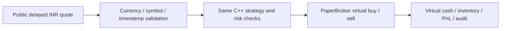

# Broker-free market-price paper practice

This mode connects public **delayed/indicative Indian equity prices** to the existing C++ `PaperBroker`. It uses virtual money and sends no orders to a broker. It needs no broker account, API key, deposit or additional Python packages.

For several symbols sharing one capital budget and recovery journal, use the [multi-symbol portfolio runner](portfolio-streaming.md). Multiple independent single-symbol sessions represent separate virtual accounts.

It is not a real-time NSE/BSE tick feed. Yahoo labels its [RELIANCE.NS quote](https://finance.yahoo.com/quote/RELIANCE.NS/) delayed; its [data-provider help](https://help.yahoo.com/kb/finance/article-exchanges-data-delays-sln2310.html) explains exchange-specific coverage. The public chart endpoint is undocumented and can change or become unavailable. An HTTP success does not make the underlying quote real-time.

## Start

Build the project as described in the README. CMake now also builds the `paper_engine` shared library. Then, from the project folder:

```powershell
.\scripts\run-live-paper.ps1
# Another practice symbol, without changing strategy code:
.\scripts\run-live-paper.ps1 -Symbol 'TCS.NS'
```

On any supported platform with Python 3.10+:

```sh
python -m live.run --symbol RELIANCE.NS
# Bounded session for a connection check:
python -m live.run --symbol RELIANCE.BO --duration 60
```

Symbols above are examples, not investment selections. `.NS` and `.BO` equity symbols are supported. If the library is in a custom build folder, pass `--library /path/to/library`. On Windows the launcher also checks the Python runtime supplied by the desktop environment, when available.

The default account starts with **INR 100,000 virtual capital**. Change `initial_capital_paise` in `config/network-paper.conf` for a different practice balance. All amounts remain integer paise. Shorting and leverage are disabled in this runner. The simulation tick, bands, size, fees, spread and liquidity are model settings, not verified exchange metadata or a broker tariff.

## What happens



The provider returns the latest completed, non-null one-minute close, paired with that bar's start timestamp. The still-forming minute is excluded. The console shows the source age and the delayed label. Fetches occur every 15 seconds by default; repeated source timestamps do not generate extra signals or replenish simulated liquidity.

Because this feed does not contain executable bid/ask depth, the runner creates an explicitly simulated spread and size around the bar close. Fills, slippage and latency remain simulations. A generated order can fill only on a later new quote. This mode is useful for workflow/accounting practice and slow forward observation; it cannot validate low-latency fills or profitability against real exchange liquidity.

The C++ engine stays alive throughout the session through a small C ABI and Python `ctypes`. It is not restarted/replayed after each poll. One event-loop thread owns all engine calls. HTTP fetches wait in a worker thread, while a periodic heartbeat continues on the owner thread. The C++ core performs no HTTP or file I/O.

## Funds and stops

The starting capital is added to net trading cash flow for the displayed virtual cash balance. Account equity is starting capital plus marked PnL. The loss limit still uses trading PnL, so a positive starting balance does not hide a daily loss.

Pending buys reserve worst-case turnover and remaining cumulative fees. Both submission and fill-time checks prevent a virtual cash overdraft. Partial fills, cancellation and completed sales release/update reservations. A cash rejection appears as `funds` in the audit.

Transport timeouts/connection errors and HTTP 408, 429, 500, 502, 503 or 504 permit bounded retries. Working paper orders are durably cancelled before waiting. The default allows three retries after the initial failure, with 5/10/20-second backoff. Server `Retry-After` seconds or HTTP dates can extend a wait up to 60 seconds; a longer requested wait stops the session rather than polling too early. Set `--max-feed-retries 0` (PowerShell: `-MaxFeedRetries 0`) to stop on the first failure; the allowed retry count is 0..10 and backoff never exceeds 60 seconds.

The owner-thread heartbeat continues during requests and retry waits. A stale-feed or other risk halt remains latched and cannot be cleared by a successful HTTP response. Exhausted retries, permanent HTTP errors, invalid payloads/currency, regressing or revised completed bars, future/out-of-session data and stale open-session quotes stop the session. There is no synthetic fallback. Existing inventory remains held and marked; cancelling pending orders does not liquidate it.

Repeated responses cannot refresh executable depth, generate signals, reset the engine's unique-quote clock or mark a degraded feed recovered. Recovery is reported only when a validated new source timestamp is accepted. Source age is checked separately from the monotonic engine clock. The default source-age ceiling is 30 minutes; unique-quote silence is limited to 180 seconds. Provider delay is not hidden by resetting its timestamp.

Outside the regular-session window published in the feed, the runner records the closing quote and stops with `market_closed`. It does not trade after hours. During an open session, Ctrl+C stops at the next event-loop boundary. End-of-session cancellation does not automatically liquidate inventory.

Each first launch creates a new practice account/session. A crash-interrupted session can be resumed from its report folder:

```sh
python -m live.run --resume reports/network-paper/20261104T090000Z-RELIANCE.NS-a1b2c3d4
```

The Windows launcher accepts the same session folder with `-Resume`:

```powershell
.\scripts\run-live-paper.ps1 -Resume 'reports/network-paper/20261104T090000Z-RELIANCE.NS-a1b2c3d4'
```

Resume uses the saved configuration and refuses a changed configuration, a finished session, or a second process holding the session lock. It replays the durable normalized-tick journal through the C++ engine and compares each saved order-event batch and account snapshot. A mismatch stops recovery. A torn final journal line is discarded; a prepared tick without a checkpoint is replayed and checkpointed because paper execution has no external side effect. After reconciliation, working paper orders are canceled before the feed resumes. If the saved quote is older than the engine stale limit, recovery latches a risk halt and does not resume trading. This is recovery of the local simulated ledger; there is no external broker order or account to reconcile.

## Reports

The session owner now holds an OS file lease. `session.lock` may remain after exit and does not itself mean a session is running. Live legacy owners are refused; stop older runners before upgrading. Lock migration and crash-release behavior are described in the [portfolio recovery guide](portfolio-streaming.md).

Find the path printed in the console, under `reports/network-paper/<UTC timestamp>-<symbol>-<id>/`:

| File | Contents |
| --- | --- |
| `summary.json` | Virtual cash/equity, PnL, inventory, fees, source age, risk/stop status. |
| `session.json` | Format, symbol, configuration fingerprint and running/finished state. |
| `session.jsonl` | Durable tick/operation journal with reconciled order events and account snapshots. |
| `audit.csv` | C++ strategy, order, fill, rejection, cancellation and kill events. |
| `source-quotes.jsonl` | Provider price and original bar timestamp plus receipt time. |
| `ticks.csv` | Normalized simulation quotes accepted by the C++ engine. |
| `config.conf` | Exact copied configuration for this session. |
| `health.json` | Atomic health snapshot: retry/poll/quote/error counters, source age, next retry, position/PnL and engine state. |
| `alerts.jsonl` | Local transition events for feed unavailability/recovery, waiting for a fresh quote and final stops. |

`finished=true` distinguishes a closed session from an intermediate report. A market-closed connection check can correctly show zero orders/fills. Clean shutdown now keeps `risk_halted=false`; the native engine is still intentionally killed to prevent later orders, so `engine_killed=true` in final health is expected. Exit `3` means a feed/risk/monitoring failure; `2` means startup/argument failure. Residual inventory and the delayed/indicative label remain visible.

Health counters explicitly cover the current process and restart at resume; the durable ledger keeps cumulative session activity. Health snapshots refresh at transitions, on responses and at most every five seconds during waits. Alerts append across resume and suppress repeated identical outage states. These files and console notices are local: no email, webhook or external notification is sent. Monitoring write failure stops paper execution. A broker-specific streaming adapter, authentication and websocket resubscription still require a selected broker.
