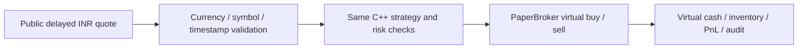

# Broker-free market-price paper practice

This mode connects public **delayed/indicative Indian equity prices** to the existing C++ `PaperBroker`. It uses virtual money and sends no orders to a broker. It needs no broker account, API key, deposit or additional Python packages.

It is not a real-time NSE/BSE tick feed. Yahoo labels its [RELIANCE.NS quote](https://finance.yahoo.com/quote/RELIANCE.NS/) delayed; its [data-provider help](https://help.yahoo.com/kb/finance/article-exchanges-data-delays-sln2310.html) explains exchange-specific coverage. The public chart endpoint is undocumented and can change or become unavailable. An HTTP success does not make the underlying quote real-time.

## Start

Build the project as described in the README. CMake now also builds the `paper_engine` shared library. Then, from the project folder:

```powershell
.\scripts\run-live-paper.ps1
# Another practice symbol, without changing strategy code:
.\scripts\run-live-paper.ps1 -Symbol 'TCS.NS'
```

On any supported platform with Python 3.10+:

```sh
python -m live.run --symbol RELIANCE.NS
# Bounded session for a connection check:
python -m live.run --symbol RELIANCE.BO --duration 60
```

Symbols above are examples, not investment selections. `.NS` and `.BO` equity symbols are supported. If the library is in a custom build folder, pass `--library /path/to/library`. On Windows the launcher also checks the Python runtime supplied by the desktop environment, when available.

The default account starts with **INR 100,000 virtual capital**. Change `initial_capital_paise` in `config/network-paper.conf` for a different practice balance. All amounts remain integer paise. Shorting and leverage are disabled in this runner. The simulation tick, bands, size, fees, spread and liquidity are model settings, not verified exchange metadata or a broker tariff.

## What happens



The provider returns the latest completed, non-null one-minute close, paired with that bar's start timestamp. The still-forming minute is excluded. The console shows the source age and the delayed label. Fetches occur every 15 seconds by default; repeated source timestamps do not generate extra signals or replenish simulated liquidity.

Because this feed does not contain executable bid/ask depth, the runner creates an explicitly simulated spread and size around the bar close. Fills, slippage and latency remain simulations. A generated order can fill only on a later new quote. This mode is useful for workflow/accounting practice and slow forward observation; it cannot validate low-latency fills or profitability against real exchange liquidity.

The C++ engine stays alive throughout the session through a small C ABI and Python `ctypes`. It is not restarted/replayed after each poll. One event-loop thread owns all engine calls. HTTP fetches wait in a worker thread, while a periodic heartbeat continues on the owner thread. The C++ core performs no HTTP or file I/O.

## Funds and stops

The starting capital is added to net trading cash flow for the displayed virtual cash balance. Account equity is starting capital plus marked PnL. The loss limit still uses trading PnL, so a positive starting balance does not hide a daily loss.

Pending buys reserve worst-case turnover and remaining cumulative fees. Both submission and fill-time checks prevent a virtual cash overdraft. Partial fills, cancellation and completed sales release/update reservations. A cash rejection appears as `funds` in the audit.

An HTTP/schema/currency error, regressing provider timestamp or stale open-session quote stops the session and cancels working paper orders. There is no automatic synthetic fallback or automatic restart. Source age is checked separately from the monotonic clock used by the engine. The default source-age ceiling is 30 minutes; the default unique-quote silence limit is 180 seconds. Provider delay is not hidden by resetting its source timestamp.

Outside the regular-session window published in the feed, the runner records the closing quote and stops with `market_closed`. It does not trade after hours. During an open session, Ctrl+C stops at the next event-loop boundary. End-of-session cancellation does not automatically liquidate inventory.

Each launch creates a **new** practice account/session. State is not automatically resumed after a restart. The unique output folder prevents accidental history overwrites.

## Reports

Find the path printed in the console, under `reports/network-paper/<UTC timestamp>-<symbol>-<id>/`:

| File | Contents |
| --- | --- |
| `summary.json` | Virtual cash/equity, PnL, inventory, fees, source age, risk/stop status. |
| `audit.csv` | C++ strategy, order, fill, rejection, cancellation and kill events. |
| `source-quotes.jsonl` | Provider price and original bar timestamp plus receipt time. |
| `ticks.csv` | Normalized simulation quotes accepted by the C++ engine. |
| `config.conf` | Exact copied configuration for this session. |

`finished=true` distinguishes a closed session from an intermediate report. A market-closed connection check can correctly show zero orders/fills. Exit `3` means a feed/risk stop; `2` means startup/argument failure. The report preserves residual inventory and labels all data delayed/indicative.
